<!-- Generated by page/build.py. Edit that file and rebuild, not this one. -->

# Where Physical AI Stands: From First-Person Video to Agents That Act

Guest lecture · EMU COSC 480/592 Computer Vision · November 17, 2026 · Yayuan Li, University of Michigan. This page is generated by [`page/build.py`](page/build.py), which also writes the page the talk is presented from, [`page/index.html`](page/index.html).

<pre>
<b>understand the field</b>
  <b>§1 what it is</b>          <b>the loop</b> · <b>embodiment</b>
  <b>§2 the anatomy</b>         <b>seven stages</b> · <b>sense</b> · <b>represent</b> · <b>anticipate</b> · <b>decide</b> · <b>act</b> · <b>verify</b>
                         <b>adapt</b>
  <b>§3 toward production</b>   <b>the missing part</b> · <b>build on today</b>
<b>go further</b>
  <b>§4 where to look next</b>  <b>keywords and links</b>
</pre>

- One pass over the field: what physical AI is, the seven stages people work on, and how far each is from production.
- Broad rather than deep. Every stage names its papers, and the last slide lists keywords to search later.
- Everything here is in [the hub](https://yayuanli-org.github.io/awesome-physical-ai/), an open database of physical AI papers. These slides are on [GitHub](https://github.com/yayuanli-org/awesome-physical-ai).
- Leave knowing which stage interests you and what to search for next.

## What physical AI is

<pre>
          the physical world, objects and the changes they undergo
                    │
              sense │                                       ▲
                    ▼                                       │
        ┌─ <b>model it</b> ───────────────────────┐                │  acting changes the world,
        │   represent ──► anticipate       │                │  so what has to be modeled
        └────────────────┬─────────────────┘                │  changes too
                         │ decide                           │
        ┌─ <b>change it</b> ────▼──────────────────┐               │
        │   act ──► verify ──► adapt        ├───────────────┘
        │   through an embodiment: a        │
        │   person wearing glasses, a       │
        │   robot, or the two together      │
        └───────────────────────────────────┘
</pre>

- The subject is the change. Who carries it is a variable: a person wearing glasses, a robot, or both.
- Model the world, then change it through an embodiment, the hub's word for who moves the atoms. Acting changes the model, so the two close into a loop.
- Every hub paper is tagged with the stages it touches, so the loop can be counted. §2 walks it one stage at a time.

<pre>
<i>where we are</i>
<b>understand the field</b>
  <b>§1 what it is</b>          <b>the loop</b> · embodiment
  §2 the anatomy         seven stages · sense · represent · anticipate · decide · act · verify
                         adapt
  §3 toward production   the missing part · build on today
<b>go further</b>
  §4 where to look next  keywords and links
</pre>

### Embodiment: who moves the atoms

<pre>
                      <b>a person</b>                     <b>a robot</b>                    <b>the two together</b>
                      ────────                     ───────                    ────────────────
   the AI's job       teach the person to do       do the task itself         share one task
   what it is good    harder tasks than <b>a robot</b>    narrow tasks, full         a couch through
   for today          can do, with <b>a person</b>'s      automation, no one         a doorway. Not in
                      hands and judgment           in the loop                the hub yet
   in the hub         48 papers                    30 papers                  6 papers
</pre>

<table><tr><td valign="top" width="33%">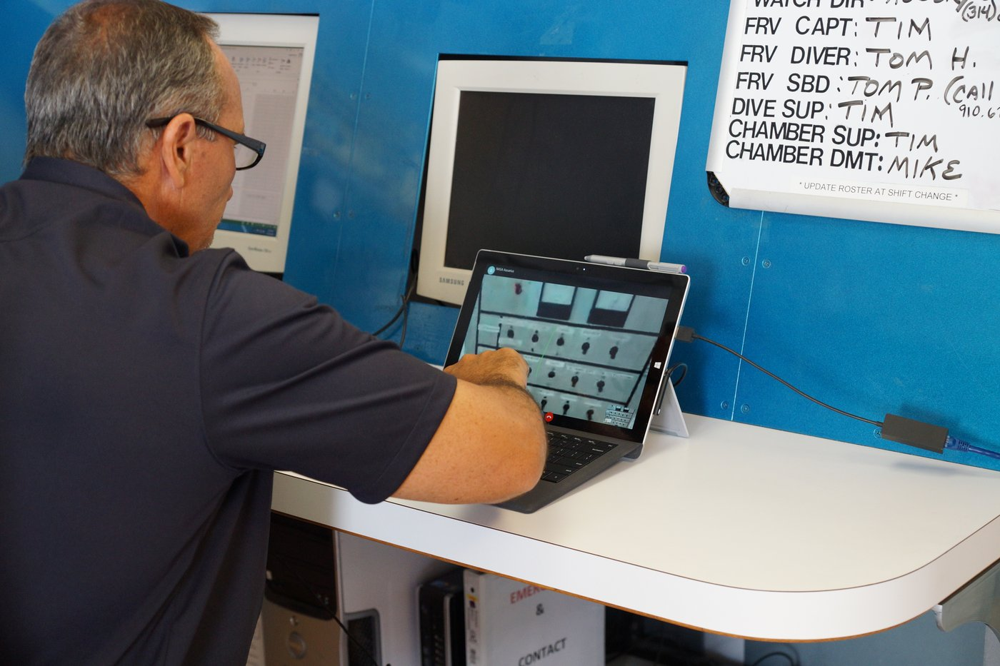</td><td valign="top" width="33%">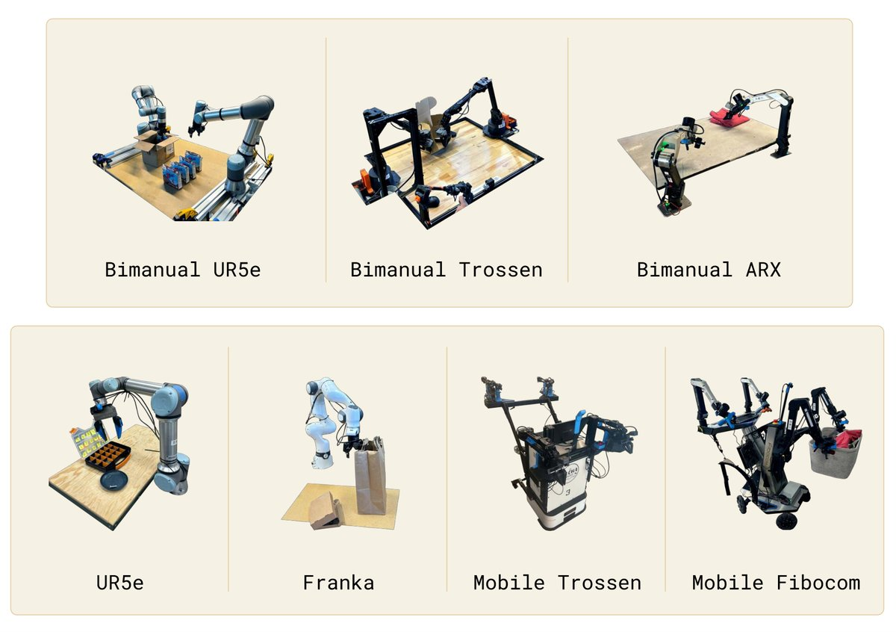</td><td valign="top" width="33%">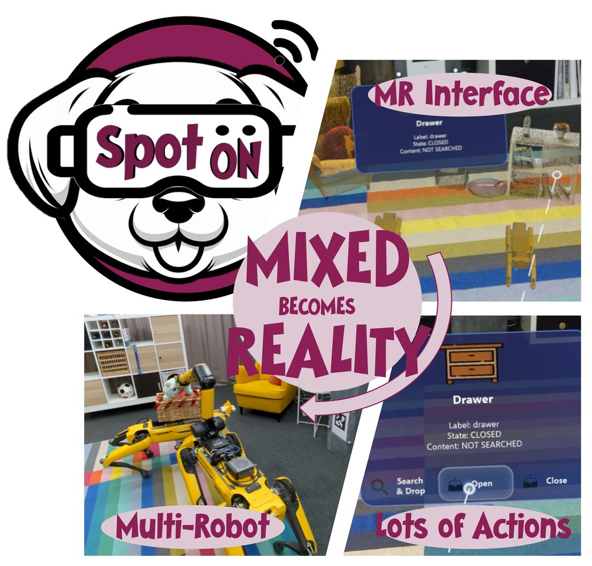</td></tr><tr><td valign="top"><b>A person.</b> An expert at a laptop circles the switch a crew member wearing a headset should flip. NASA NEEMO, 2015.</td><td valign="top"><b>A robot.</b> The seven platforms one π₀ policy drives, from a single arm to a mobile bimanual base. Black et al., 2024.</td><td valign="top"><b>Together.</b> A person in mixed reality directs a team of quadrupeds through doors, drawers and light switches. Spot-On, 2025.</td></tr></table>

- The AI either teaches a person or is the robot. A person brings hands and judgment, and a robot brings full automation on a narrow task.
- People handle harder tasks than robots today, so a human-side system deploys earlier, and its footage trains the robot later. EgoDex, EgoVLA and DexUMI already do this.
- A person and a robot on one task is the smallest branch, 6 of 110 papers, and the one the next decade needs.
- Both embodiments change the world, so every stage in §2 keeps two rows, a person above and a robot below.

<pre>
<i>where we are</i>
<b>understand the field</b>
  <b>§1 what it is</b>          <b>the loop</b> · <b>embodiment</b>
  §2 the anatomy         seven stages · sense · represent · anticipate · decide · act · verify
                         adapt
  §3 toward production   the missing part · build on today
<b>go further</b>
  §4 where to look next  keywords and links
</pre>

## The anatomy of the field: seven stages

<pre>
          the physical world, objects and the changes they undergo
                    │
          <b>2.1 sense</b> │                                       ▲
                    ▼                                       │
        ┌─ model it ───────────────────────────────┐        │
        │   <b>2.2 represent</b> ──► <b>2.3 anticipate</b>       │        │  the loop of §1, with the
        └────────────────────────┬─────────────────┘        │  stage each subsection
                                 │ <b>2.4 decide</b>               │  walks written onto it
        ┌─ change it ────────────▼─────────────────┐        │
        │   <b>2.5 act</b> ──► <b>2.6 verify</b> ──► <b>2.7 adapt</b>   ├────────┘
        └──────────────────────────────────────────┘
</pre>

- The research topics of the field are the seven stages of the loop in §1. Each gets a subsection: what it is, what people build, where it stands.
- Every subsection keeps the two rows of embodiment, because the same stage is a different problem for a person and for a robot.
- Two stages, 2.6 verify and 2.7 adapt, are where the hub is thinnest, and the lecture ends up there.

<table>
<thead><tr><th>stage</th><th>the question it answers</th><th>papers that live there</th></tr></thead>
<tbody>
<tr><td>2.1 sense</td><td>turn sensors into observations</td><td>SAM 2, HOT3D</td></tr>
<tr><td>2.2 represent</td><td>turn observations into a state you can act on</td><td>DINOv2, 3D Gaussian Splatting</td></tr>
<tr><td>2.3 anticipate</td><td>predict what the world does next</td><td>V-JEPA 2, Genie</td></tr>
<tr><td>2.4 decide</td><td>choose the next step or the plan</td><td>SayCan, VLaMP</td></tr>
<tr><td>2.5 act</td><td>emit the action: a motor command, an instruction, an overlay</td><td>π₀, ShowHowTo</td></tr>
<tr><td>2.6 verify</td><td>check whether the intended change happened</td><td>PREGO, SAFE</td></tr>
<tr><td>2.7 adapt</td><td>change the policy or the model from the outcome</td><td>Every Mistake Counts, Inner Monologue</td></tr>
</tbody></table>

- A paper touches two or three stages as a rule. 81 of the 110 do.
- A vision-language-action policy (camera and instruction in, joint commands out) is sense, decide, act. A task assistant on glasses is sense, decide, act, verify.
- A person skipping a step and a robot policy failing are the same verify stage, and the two literatures barely cite each other.

<pre>
<i>where we are</i>
<b>understand the field</b>
  <b>§1 what it is</b>          <b>the loop</b> · <b>embodiment</b>
  <b>§2 the anatomy</b>         <b>seven stages</b> · sense · represent · anticipate · decide · act · verify
                         adapt
  §3 toward production   the missing part · build on today
<b>go further</b>
  §4 where to look next  keywords and links
</pre>

### 2.1 Sense: what the hardware sees, and where the signal stops

<b>a person</b>
<table><tr><td valign="top" width="25%">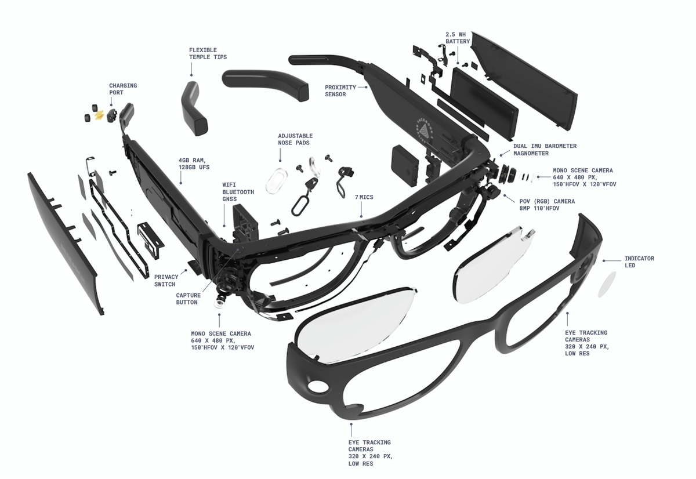</td><td valign="top" width="25%">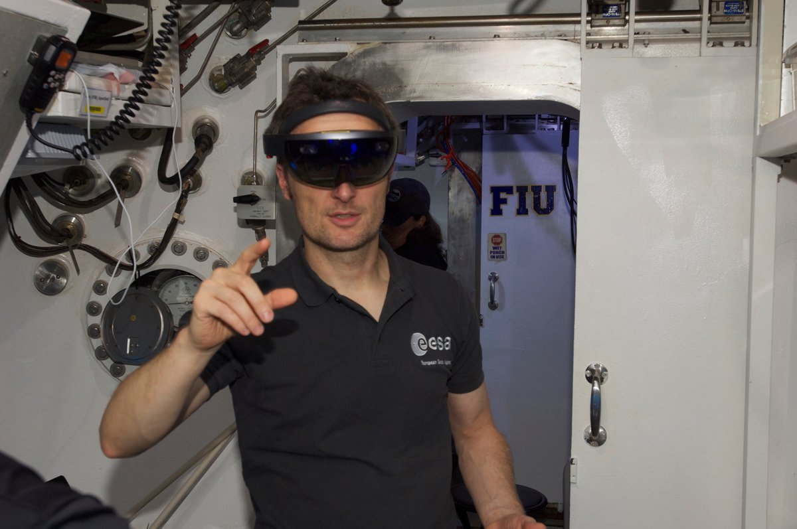</td><td valign="top" width="25%"></td><td valign="top" width="25%">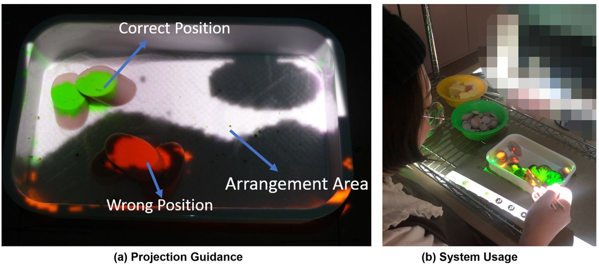</td></tr><tr><td valign="top"><b>Research glasses.</b> Project Aria carries two scene cameras, an RGB camera, two eye cameras, seven microphones and two IMUs. Meta, 2023.</td><td valign="top"><b>A headset with a display.</b> HoloLens adds a depth camera, hand tracking, and holograms drawn in the wearer's view. NASA NEEMO 21.</td><td valign="top"><b>Consumer glasses.</b> Ray-Ban Meta has one camera, microphones and speakers, and since September 2025 a display in the lens, for $799.</td><td valign="top"><b>Projector and camera.</b> The instruction is drawn onto the workspace itself, and no one wears anything. SketchMeHow, 2021.</td></tr></table>

- A camera on the head sees what the person sees. 51 of the 110 papers start from that stream, more than from any other sensor.
- The return channel is the second half of the hardware, a display in the lens, a speaker, or a projector that draws on the table.
- The view is partial, hidden by the hands, and moving. All-day glasses with a display are arriving at consumer prices from three vendors in 2026.

<b>a robot</b>
<table><tr><td valign="top" width="50%">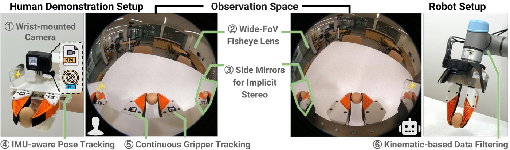</td><td valign="top" width="50%">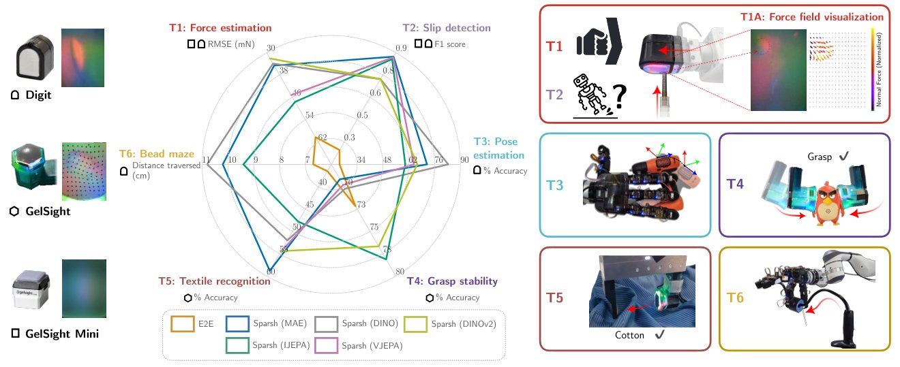</td></tr><tr><td valign="top"><b>A camera on the wrist.</b> UMI's gripper carries a wide-angle camera, side mirrors for stereo and an IMU, and is held by a person or bolted to an arm. Chi et al., 2024.</td><td valign="top"><b>Touch.</b> Vision-based tactile pads (DIGIT, GelSight) film a gel as it deforms. Sparsh learns from 460k such images. Meta, 2024.</td></tr></table>

<table><tr><td valign="top" width="33%">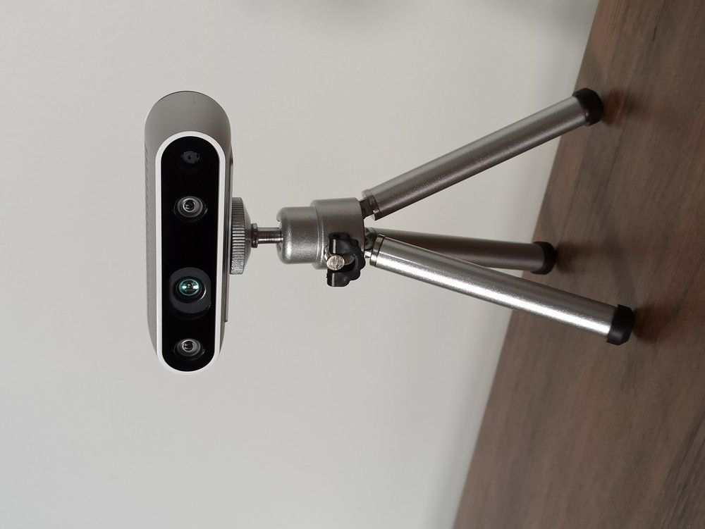</td><td valign="top" width="33%"></td><td valign="top" width="33%">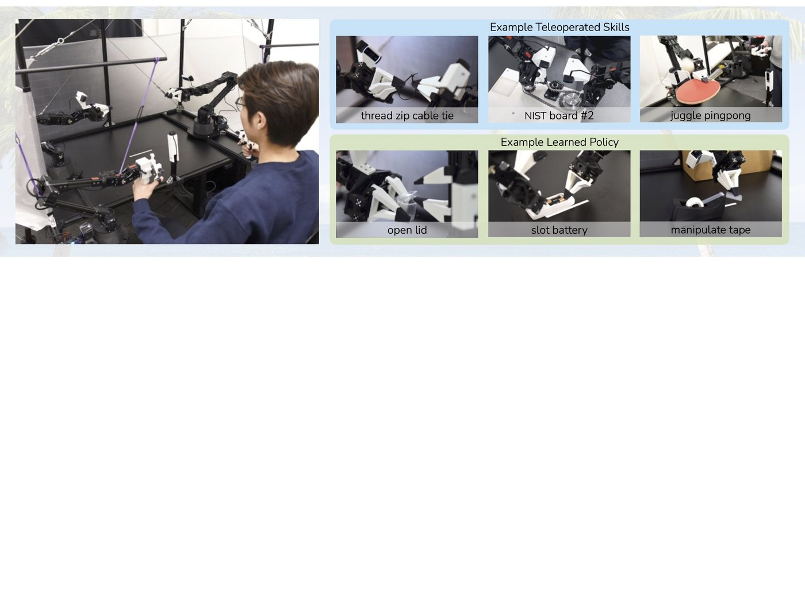</td></tr><tr><td valign="top"><b>Depth.</b> A stereo depth camera returns a point cloud, the usual source of the hub's 3D. Intel RealSense D435.</td><td valign="top"><b>Range.</b> LiDAR sweeps a laser and returns distance, standard on mobile robots and rare on arms. Velodyne.</td><td valign="top"><b>The whole rig.</b> ALOHA puts two cameras over the table and one on each wrist, and a person moves the leader arms to teach it. Zhao et al., 2023.</td></tr></table>

- A robot's cameras sit on the wrist and over the table. Depth and LiDAR add range, and a tactile pad on the fingertip adds contact.
- Touch is where the hub is thinnest. 2 of 110 papers sense it, and 8 hold force, mass or friction in their state.
- Every sensor is calibrated and priced per arm. Hand-held grippers (UMI, DexUMI) are the way around it, because the data arrives with no robot in the room.

<pre>
<i>where we are</i>
<b>understand the field</b>
  <b>§1 what it is</b>          <b>the loop</b> · <b>embodiment</b>
  <b>§2 the anatomy</b>         <b>seven stages</b> · <b>sense</b> · represent · anticipate · decide · act · verify
                         adapt
  §3 toward production   the missing part · build on today
<b>go further</b>
  §4 where to look next  keywords and links
</pre>

### 2.2 Represent: there is no best representation, only the one for the job

<pre>
   <b>2012</b>  AlexNet                supervised features from a labeled corpus
   <b>2017</b>  Transformer            attention, built to train in parallel on GPUs
   <b>2020</b>  ViT · NeRF             an image as patches; a scene as a neural field
   <b>2021</b>  CLIP · MAE · DINO      image and text in one space; masked and self-distilled features
   <b>2022</b>  latent diffusion       generate; the representation is what a denoiser learns
   <b>2023</b>  I-JEPA · DINOv2 · 3DGS predict in latent space; frozen features; explicit geometry
   <b>2024</b>  V-JEPA                 the same prediction over video
   <b>2025</b>  V-JEPA 2 · DINOv3      video → latent world model → robot planning
</pre>

- Representation learning is this stage. Each milestone changed what a downstream model can read off an image, from labels to language to geometry to the future.
- The transformer won on parallel training, not accuracy. A ViT trails a ResNet on mid-sized data and only wins past 14M images (Dosovitskiy et al., 2020).
- When compute stops binding, other designs come back. All-MLP (MLP-Mixer, 2021) and recurrent (Mamba, 2023) models both match transformers on their benchmarks.

<table><tr><td valign="top" width="50%">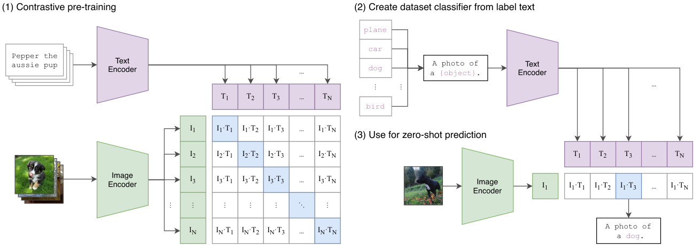</td><td valign="top" width="50%">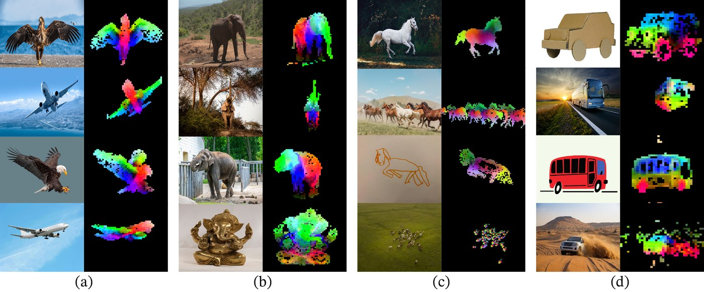</td></tr><tr><td valign="top"><b>Language-aligned.</b> CLIP puts an image and its caption in one space, so a class can be named instead of labeled. Radford et al., 2021.</td><td valign="top"><b>Self-supervised.</b> The first three components of DINOv2's features, with no labels, already separate parts. Oquab et al., 2023.</td></tr></table>

<table><tr><td valign="top" width="50%">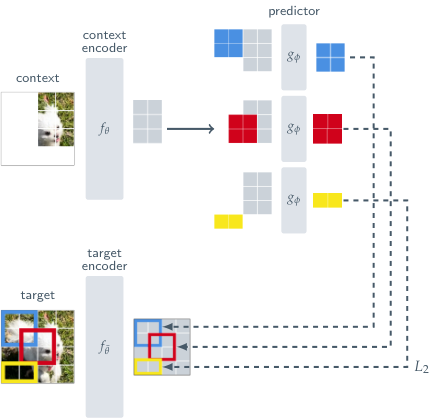</td><td valign="top" width="50%">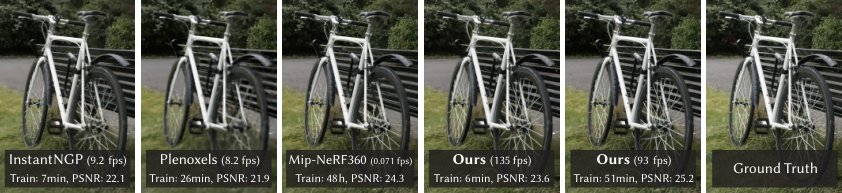</td></tr><tr><td valign="top"><b>Predictive.</b> I-JEPA predicts the representation of a masked region, never the pixels. Assran et al., 2023.</td><td valign="top"><b>Geometric.</b> 3D Gaussian Splatting holds a scene as explicit primitives that render in real time. Kerbl et al., 2023.</td></tr></table>

- There is no best one. Half the hub's world models start from a frozen DINOv2 because freezing it is cheap, not because it fits their task.
- The choice follows the need and the budget. Language-aligned to follow instructions, geometric to plan a grasp, predictive to anticipate, and a convnet when production data is small.
- Read a representation paper for the downstream task it was tested on. That is the job it is good for, and often the only one.

<pre>
<i>where we are</i>
<b>understand the field</b>
  <b>§1 what it is</b>          <b>the loop</b> · <b>embodiment</b>
  <b>§2 the anatomy</b>         <b>seven stages</b> · <b>sense</b> · <b>represent</b> · anticipate · decide · act · verify
                         adapt
  §3 toward production   the missing part · build on today
<b>go further</b>
  §4 where to look next  keywords and links
</pre>

### 2.3 Anticipate: think before you move

<table><tr><td valign="top" width="50%">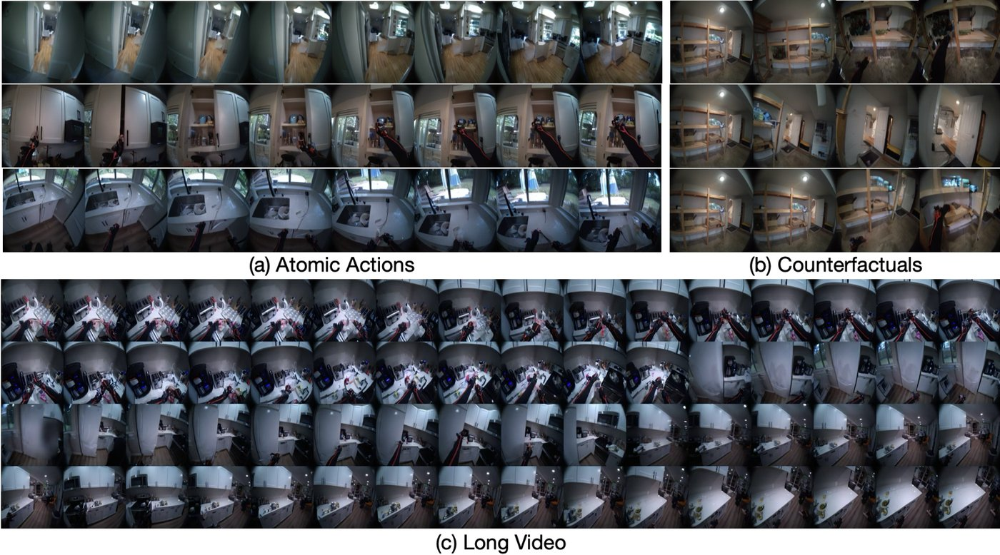</td><td valign="top" width="50%">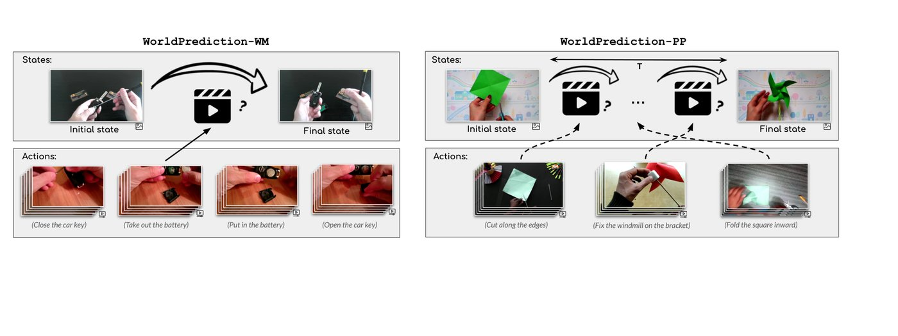</td></tr><tr><td valign="top"><b>A body's world model.</b> PEVA predicts first-person video from the wearer's own 3D pose, and can render the counterfactual move. Bai et al., 2025.</td><td valign="top"><b>The semantic side.</b> WorldPrediction tests whether a model can say which action took a scene from state A to state B, and in which order. 2025.</td></tr></table>

- People think before they move, and often run the counterfactual first: what fails if I slice the potato instead of dicing it. Physical AI needs the same stage.
- The text side reasons over steps and effects. Procedural reasoning and counterfactual reasoning are the search terms, and WorldPrediction benchmarks both.
- The vision side is the world model, a video generator rendering the action and its effect from the actor's viewpoint. PEVA for a body, V-JEPA 2 for a robot.
- A person and a robot follow the prediction differently. That difference is 2.4 and 2.5.

<table><tr><td valign="top" width="100%">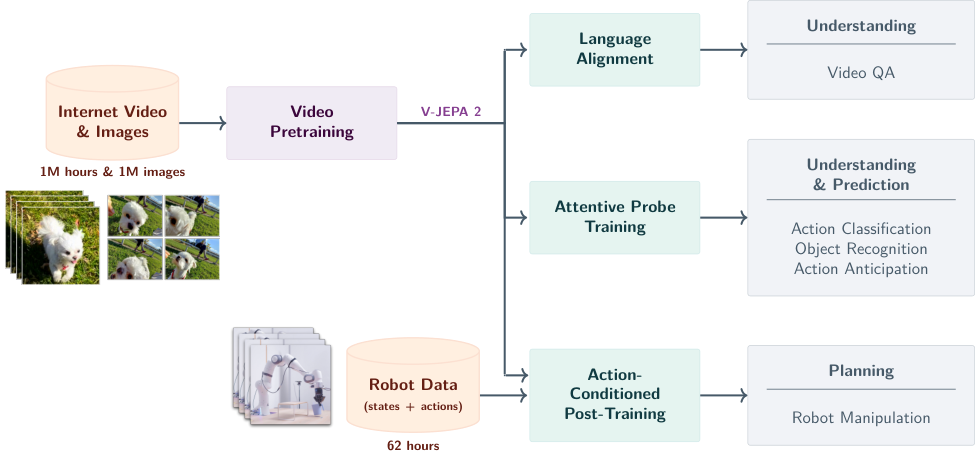</td></tr><tr><td valign="top"><b>Video in, robot out.</b> V-JEPA 2 learns from a million hours of internet video, then 62 hours of unlabeled robot video, then picks and places on an arm in a lab it never saw. Meta, 2025.</td></tr></table>

- Only the last 62 hours involve a robot. The planner samples actions and keeps the one whose predicted latent lands nearest the goal.
- Predicted futures still break physics where it can be measured. Text-to-video models fail most of PhyGenBench's 27 laws, and scale does not close the gap.

<pre>
<i>where we are</i>
<b>understand the field</b>
  <b>§1 what it is</b>          <b>the loop</b> · <b>embodiment</b>
  <b>§2 the anatomy</b>         <b>seven stages</b> · <b>sense</b> · <b>represent</b> · <b>anticipate</b> · decide · act · verify
                         adapt
  §3 toward production   the missing part · build on today
<b>go further</b>
  §4 where to look next  keywords and links
</pre>

### 2.4 Decide: pick one future, and say why

<table><tr><td valign="top" width="100%">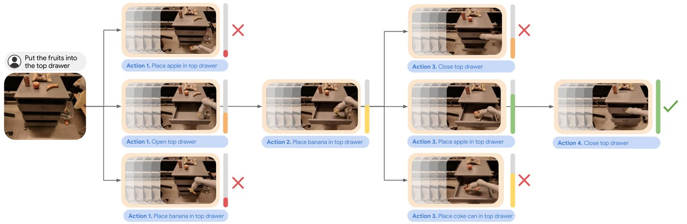</td></tr><tr><td valign="top"><b>Sample, score, choose.</b> Video Language Planning grows a tree of generated video futures and keeps the branch a value model scores highest. Du et al., 2023.</td></tr></table>

- Selection is a search over imagined outcomes. Video Language Planning searches a tree of generated clips, and V-JEPA 2 samples actions and picks by predicted cost.
- More compute buys a better plan in both, which is the argument for keeping anticipate and decide separable even when one network does both.

<b>a person</b>
<table><tr><td valign="top" width="50%">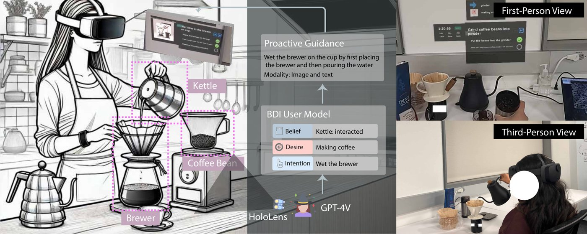</td><td valign="top" width="50%">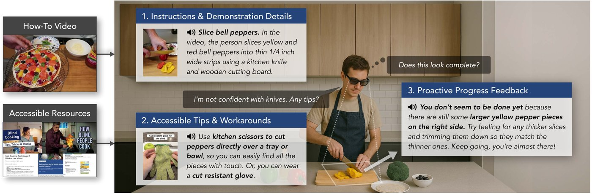</td></tr><tr><td valign="top"><b>When to speak.</b> Satori models what the person believes, wants and intends, and decides on its own when to show guidance. Li et al., 2024.</td><td valign="top"><b>What to say.</b> Vid2Coach turns a how-to video into instructions a blind cook can act on, with a completion check per step. Huh et al., 2025.</td></tr></table>

<table><tr><td valign="top" width="100%">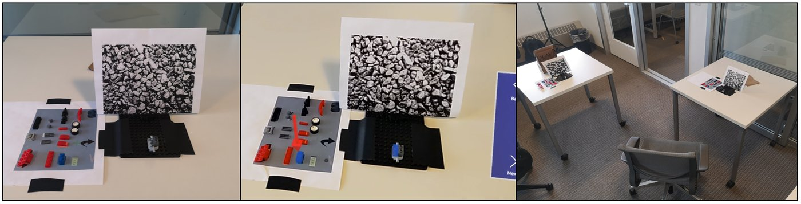</td></tr><tr><td valign="top"><b>How much to show.</b> AR guidance for assembly made workers 31% faster, and they made more errors. 2025.</td></tr></table>

- For a person, deciding includes what to say and when. Satori's authors call timing the hard problem, and the AR study shows more guidance is not better.
- Too much and the person is overwhelmed, too little and they distrust it. A chatbot's essay followed by three options is the virtual version of the same failure.
- The physical version has stakes. A step near fire, electricity or a patient needs a decision the person can check before acting, with the reason attached.

<pre>
<i>where we are</i>
<b>understand the field</b>
  <b>§1 what it is</b>          <b>the loop</b> · <b>embodiment</b>
  <b>§2 the anatomy</b>         <b>seven stages</b> · <b>sense</b> · <b>represent</b> · <b>anticipate</b> · <b>decide</b> · act · verify
                         adapt
  §3 toward production   the missing part · build on today
<b>go further</b>
  §4 where to look next  keywords and links
</pre>

### 2.5 Act: a person just acts, a robot has to be controlled

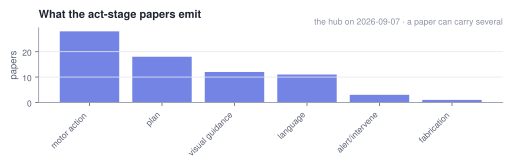

- For a person, act is the easy stage. Given a good decision, they do it. The system's act is an instruction, an image or an overlay.
- For a robot, act is control, the chosen plan turned into joint commands at tens of hertz. All of robot learning lives in the motor-action bar.

<pre>
   <b>2022</b>  Code as Policies       the language model writes the program that calls the controller
   <b>2022</b>  RT-1                   a transformer maps camera and instruction to discrete actions
   <b>2023</b>  Diffusion Policy · ACT actions as a denoised trajectory; commit to a chunk at a time
   <b>2023</b>  RT-2                   a VLM fine-tuned to emit actions as tokens: the first VLA
   <b>2024</b>  OpenVLA · π₀           an open 7B VLA; a flow-matching action head across bodies
   <b>2025</b>  GR00T N1 · π₀.₅        a slow reasoner over a fast actor; open-world generalization
   <b>2025–26</b>  Genie Envisioner · DreamZero   world action models: predict the video and the action together
</pre>

- Four branches compete: write the program, denoise the trajectory, emit action tokens from a VLM, or predict video and action together. No one knows yet which wins.
- Diffusion Policy beat the prior state of the art by 46.9% across 12 tasks. OpenVLA beat RT-2-X by 16.5 points with 7× fewer parameters.
- A world action model folds anticipate, decide and act into one network. DreamZero runs 14B parameters closed-loop at 7 Hz and generalizes twice as well as VLAs.

<pre>
<i>where we are</i>
<b>understand the field</b>
  <b>§1 what it is</b>          <b>the loop</b> · <b>embodiment</b>
  <b>§2 the anatomy</b>         <b>seven stages</b> · <b>sense</b> · <b>represent</b> · <b>anticipate</b> · <b>decide</b> · <b>act</b> · verify
                         adapt
  §3 toward production   the missing part · build on today
<b>go further</b>
  §4 where to look next  keywords and links
</pre>

### 2.6 Verify: close the loop on what happened

<b>a robot</b>
<table><tr><td valign="top" width="33%">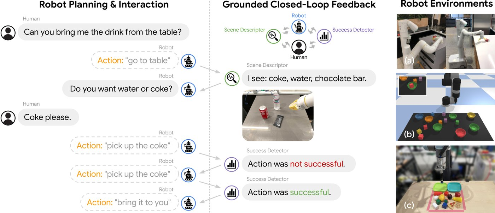</td><td valign="top" width="33%">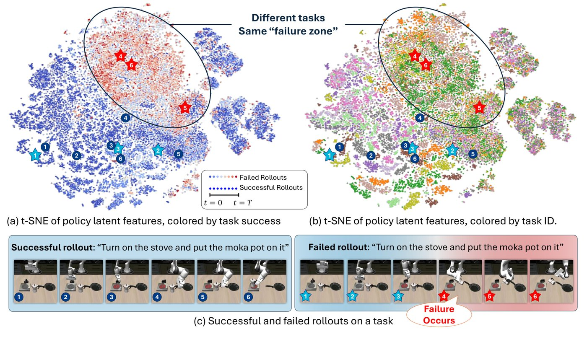</td><td valign="top" width="33%">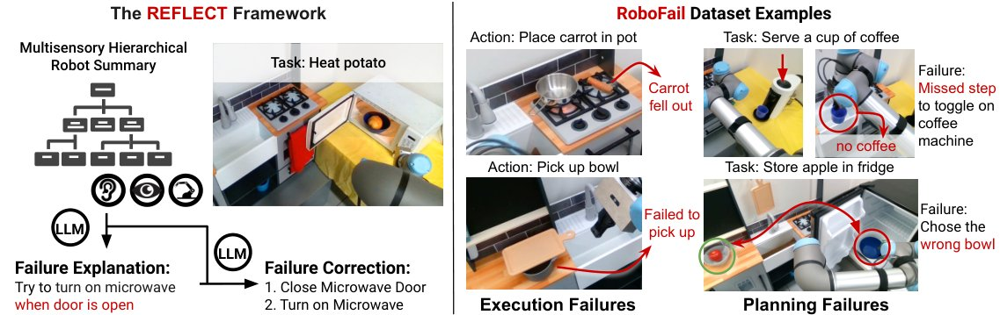</td></tr><tr><td valign="top"><b>Feed the outcome back.</b> Inner Monologue hands the planner a success flag, a scene description or a person's answer after every skill. Huang et al., 2022.</td><td valign="top"><b>Read failure off the policy.</b> SAFE finds a failure zone in a VLA's own features and alerts before the task is lost. Gu et al., 2025.</td><td valign="top"><b>Explain it.</b> REFLECT summarizes what the robot sensed and asks a language model why the task failed, then replans. Liu et al., 2023.</td></tr></table>

- Verify is what makes the next decision rest on what happened rather than on what was intended. Without it the loop is open, however good the policy.
- The robot side has had it since Inner Monologue, a check after every step and a replan. SAFE detects the failure and REFLECT explains it.

<b>a person</b>
<table><tr><td valign="top" width="33%">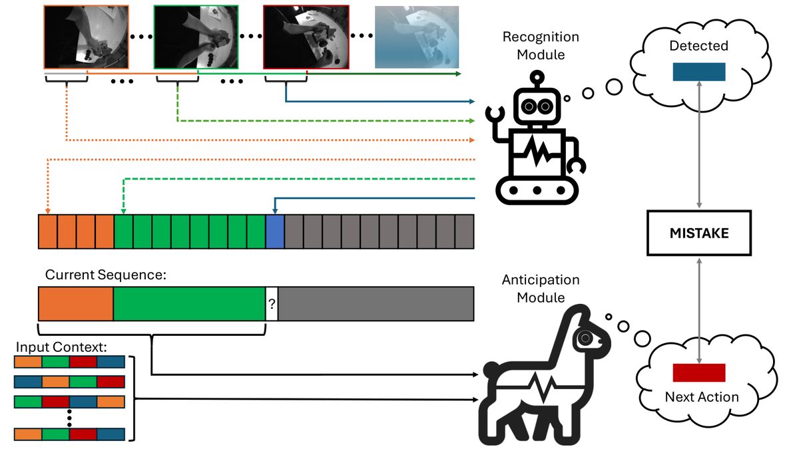</td><td valign="top" width="33%">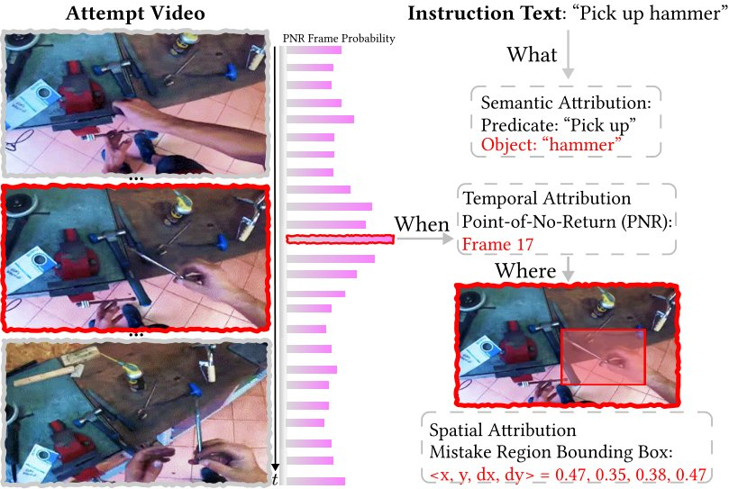</td><td valign="top" width="33%">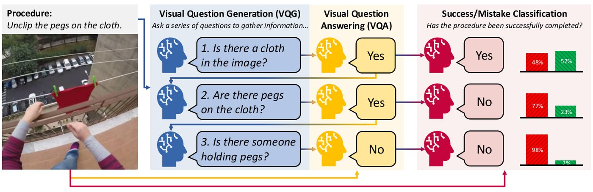</td></tr><tr><td valign="top"><b>Detect the mistake.</b> PREGO recognizes the current step, predicts what should come next, and flags the disagreement, trained on correct runs only. CVPR 2024.</td><td valign="top"><b>Attribute it.</b> Mistake Attribution says which part of the instruction was violated, the frame of no return, and where in the frame. 2025.</td><td valign="top"><b>Explain it.</b> Transparent PMD requires a rationale and scores whether the rationale entails the verdict. Storks et al., EMNLP 2025.</td></tr></table>

- The human side calls it mistake detection. The intervals are longer, a step rather than a motor command, and the verdict needs a reason the person will accept.
- The research has moved from a flag to an account of what was wrong, when it became irreversible, where in the frame, and why the system thinks so.
- The two literatures ask the same question at the same stage and barely cite each other.

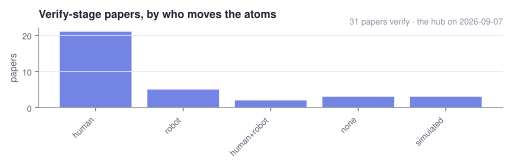

<table><caption>Who closes the loop, in the hub on 2026-09-07. A paper closes the loop when it consumes the effect of its own action at run time.</caption>
<thead><tr><th>embodiment</th><th>papers</th><th>close the loop</th><th>%</th></tr></thead>
<tbody>
<tr><td>Human</td><td>48</td><td>14</td><td>29</td></tr>
<tr><td>Robot</td><td>30</td><td>23</td><td>77</td></tr>
<tr><td>Human+Robot</td><td>6</td><td>5</td><td>83</td></tr>
<tr><td>None</td><td>23</td><td>2</td><td>9</td></tr>
<tr><td>Simulated</td><td>11</td><td>9</td><td>82</td></tr>
</tbody></table>

- 21 of the 31 verify papers watch a person. 5 watch a robot.
- 23 of the 30 robot papers consume the effect of their own action. 14 of the 48 human ones do. Most guidance systems emit an instruction and stop.
- A robot policy that never looked at the result would not get published. A guidance system that never does is the norm. That gap is a project.

<pre>
<i>where we are</i>
<b>understand the field</b>
  <b>§1 what it is</b>          <b>the loop</b> · <b>embodiment</b>
  <b>§2 the anatomy</b>         <b>seven stages</b> · <b>sense</b> · <b>represent</b> · <b>anticipate</b> · <b>decide</b> · <b>act</b> · <b>verify</b>
                         adapt
  §3 toward production   the missing part · build on today
<b>go further</b>
  §4 where to look next  keywords and links
</pre>

### 2.7 Adapt: better on the next attempt because of the last one

<table><tr><td valign="top" width="50%">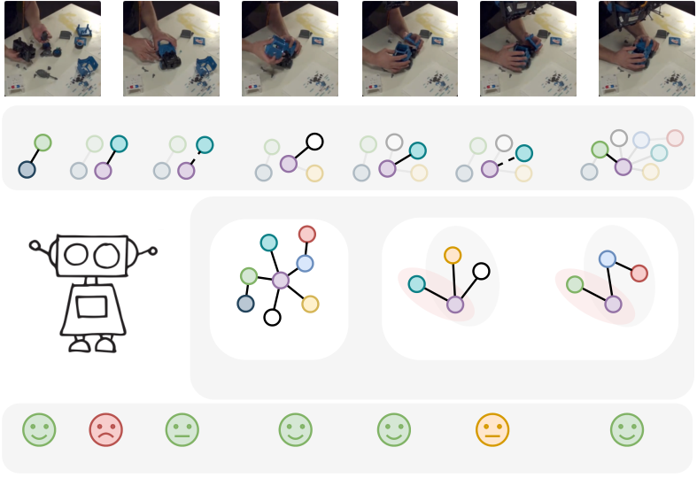</td><td valign="top" width="50%">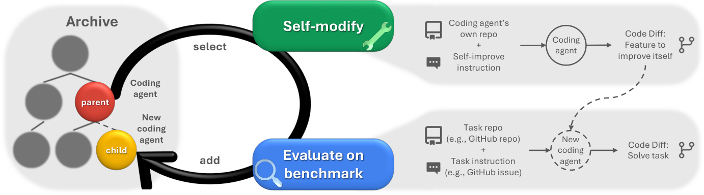</td></tr><tr><td valign="top"><b>In the physical world.</b> Every Mistake Counts keeps a graph of which parts fit and what must come first, and updates it as it watches. Ding et al., 2023.</td><td valign="top"><b>In code.</b> The Darwin Gödel Machine rewrites its own agent code and keeps the versions that score higher. Zhang et al., 2025.</td></tr></table>

<table><tr><td valign="top" width="100%">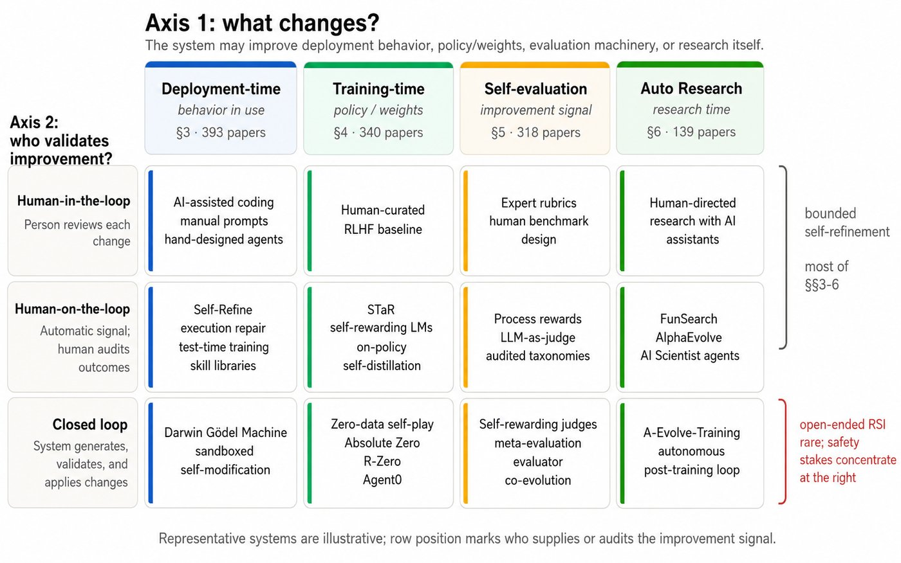</td></tr><tr><td valign="top"><b>The map.</b> A July 2026 survey of 1,250 papers sorts self-improvement by what changes and how closed the loop is. Most of it is bounded self-refinement.</td></tr></table>

- The old name is continual learning. The new one is self-evolving AI, and it covers the harness around the model as well as its weights.
- The frontier labs run it on coding agents, where the loop closes cheaply. The Darwin Gödel Machine and its relatives rewrite their own code and keep what scores.
- The same survey finds the open-ended version bounded on every measured axis, and MIT Technology Review's August 2026 read is that it is not coming quickly.
- Physical AI needs it too. A guidance system that changes its next instruction because of what the last one did is this stage, and the stage is empty.

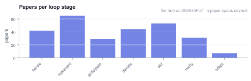

- 7 of 110 papers adapt. The field can tell that something went wrong and almost never learns from it while running.
- The exceptions are from 2023 and 2022. Every Mistake Counts updates its constraints as it watches, and Inner Monologue feeds the outcome back as text.

<pre>
<i>where we are</i>
<b>understand the field</b>
  <b>§1 what it is</b>          <b>the loop</b> · <b>embodiment</b>
  <b>§2 the anatomy</b>         <b>seven stages</b> · <b>sense</b> · <b>represent</b> · <b>anticipate</b> · <b>decide</b> · <b>act</b> · <b>verify</b>
                         <b>adapt</b>
  §3 toward production   the missing part · build on today
<b>go further</b>
  §4 where to look next  keywords and links
</pre>

<pre>
          the physical world, objects and the changes they undergo
                    │
          <b>2.1 sense</b> │                                       ▲
                    ▼                                       │
        ┌─ model it ───────────────────────────────┐        │
        │   <b>2.2 represent</b> ──► <b>2.3 anticipate</b>       │        │  the loop of §1, with the
        └────────────────────────┬─────────────────┘        │  stage each subsection
                                 │ <b>2.4 decide</b>               │  walks written onto it
        ┌─ change it ────────────▼─────────────────┐        │
        │   <b>2.5 act</b> ──► <b>2.6 verify</b> ──► <b>2.7 adapt</b>   ├────────┘
        └──────────────────────────────────────────┘
</pre>

## Toward production and real-world impact

### The missing part is data

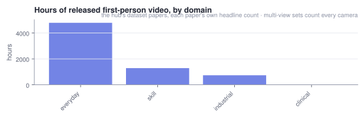

<table><caption>The datasets behind the bars, with each paper's own count. Assembly101's 513 hours are 12 views of 362 seven-minute sequences.</caption>
<thead><tr><th>dataset</th><th>hours</th><th>tier</th><th>note</th><th>source</th></tr></thead>
<tbody>
<tr><td>Ego4D</td><td>3670</td><td>everyday</td><td>unscripted daily life</td><td>arXiv 2110.07058</td></tr>
<tr><td>EgoDex</td><td>829</td><td>everyday</td><td>tabletop manipulation with hand tracking</td><td>arXiv 2505.11709</td></tr>
<tr><td>EPIC-KITCHENS-100</td><td>100</td><td>everyday</td><td>kitchens</td><td>arXiv 2006.13256</td></tr>
<tr><td>CaptainCook4D</td><td>94.5</td><td>everyday</td><td>recipes with induced errors</td><td>arXiv 2312.14556</td></tr>
<tr><td>HD-EPIC</td><td>41</td><td>everyday</td><td>kitchens with a digital twin</td><td>arXiv 2502.04144</td></tr>
<tr><td>HowToDIV</td><td>24</td><td>everyday</td><td>clips behind generated dialogues</td><td>arXiv 2508.11192</td></tr>
<tr><td>HOT3D</td><td>13.9</td><td>everyday</td><td>833 minutes of hand and object tracking</td><td>arXiv 2411.19167</td></tr>
<tr><td>EgoOops</td><td>6.8</td><td>everyday</td><td>text-following tasks with mistakes</td><td>arXiv 2410.05343</td></tr>
<tr><td>HUMOTO</td><td>2.2</td><td>everyday</td><td>mocap human-object interaction</td><td>arXiv 2504.10414</td></tr>
<tr><td>Ego-Exo4D</td><td>1286</td><td>skill</td><td>ego and exo cameras combined; 5035 takes</td><td>arXiv 2311.18259</td></tr>
<tr><td>Assembly101</td><td>513</td><td>industrial</td><td>12 views of toy-vehicle assembly; 362 sequences of 7 min</td><td>arXiv 2203.14712</td></tr>
<tr><td>HoloAssist</td><td>166</td><td>industrial</td><td>instructor talks a performer through a task</td><td>arXiv 2309.17024</td></tr>
<tr><td>Ego-EXTRA</td><td>50</td><td>industrial</td><td>expert plays the assistant</td><td>arXiv 2512.13238</td></tr>
<tr><td>IndustReal</td><td>5.8</td><td>industrial</td><td>84 assembly and maintenance sequences</td><td>arXiv 2310.17323</td></tr>
</tbody></table>

- About 4,800 hours of everyday life, 1,286 of skill from one dataset, 735 industrial, 513 of them twelve views of toy assembly, and nothing clinical.
- The professional end owns the value and the intellectual property. Hospitals and factories do not release footage, so the largest record of expert guidance is 50 hours.
- Impact in production is a data problem before a method problem. The routes are one-demonstration learning, synthetic data, or data that never leaves the site.

<pre>
<i>where we are</i>
<b>understand the field</b>
  <b>§1 what it is</b>          <b>the loop</b> · <b>embodiment</b>
  <b>§2 the anatomy</b>         <b>seven stages</b> · <b>sense</b> · <b>represent</b> · <b>anticipate</b> · <b>decide</b> · <b>act</b> · <b>verify</b>
                         <b>adapt</b>
  <b>§3 toward production</b>   <b>the missing part</b> · build on today
<b>go further</b>
  §4 where to look next  keywords and links
</pre>

### What you can build on today

<table><tr><td valign="top" width="50%">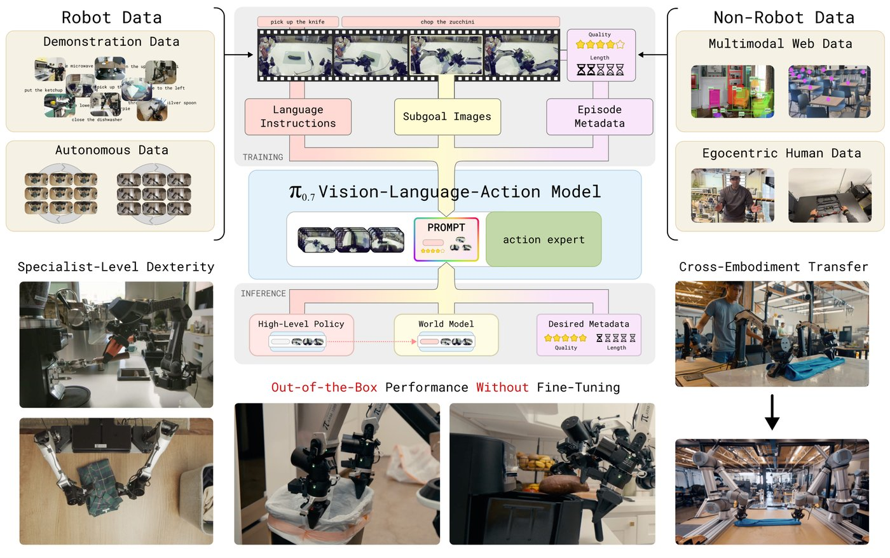</td><td valign="top" width="50%">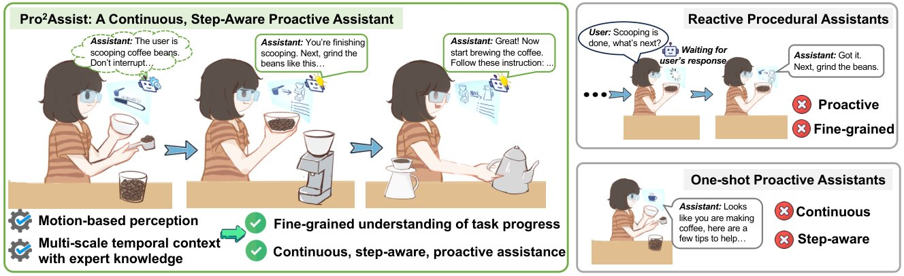</td></tr><tr><td valign="top"><b>For a robot, π₀.₇</b>, Physical Intelligence, April 2026. Follows instructions in kitchens it never saw and folds laundry on a robot that never trained on it. <a href='https://www.pi.website/blog/pi07'>blog</a> · <a href='https://arxiv.org/abs/2604.15483'>arXiv</a></td><td valign="top"><b>For a person, Pro²Assist</b>, May 2026. Tracks step progress from AR-glasses sensing and decides when to help, through a whole procedure. <a href='https://arxiv.org/abs/2605.04227'>arXiv</a></td></tr></table>

- Two links, one per embodiment, to the latest thing you can start from.
- Both are stacks of 2.1 to 2.5, and the robot one is a product. Neither adapts.

<pre>
<i>where we are</i>
<b>understand the field</b>
  <b>§1 what it is</b>          <b>the loop</b> · <b>embodiment</b>
  <b>§2 the anatomy</b>         <b>seven stages</b> · <b>sense</b> · <b>represent</b> · <b>anticipate</b> · <b>decide</b> · <b>act</b> · <b>verify</b>
                         <b>adapt</b>
  <b>§3 toward production</b>   <b>the missing part</b> · <b>build on today</b>
<b>go further</b>
  §4 where to look next  keywords and links
</pre>

## Where to look next

<table>
<thead><tr><th>stage</th><th>search for</th><th>start with</th></tr></thead>
<tbody>
<tr><td>2.1 sense</td><td>egocentric video, smart glasses, tactile sensing</td><td>SAM 2, HOT3D</td></tr>
<tr><td>2.2 represent</td><td>representation learning, self-supervised learning, JEPA</td><td>DINOv2, 3D Gaussian Splatting</td></tr>
<tr><td>2.3 anticipate</td><td>world models, procedural reasoning, counterfactual reasoning</td><td>V-JEPA 2, Genie</td></tr>
<tr><td>2.4 decide</td><td>task planning with language models, video language planning, proactive AR assistants</td><td>SayCan, VLaMP</td></tr>
<tr><td>2.5 act</td><td>vision-language-action models, diffusion policy, world action models</td><td>π₀, ShowHowTo</td></tr>
<tr><td>2.6 verify</td><td>mistake detection, failure detection</td><td>PREGO, SAFE</td></tr>
<tr><td>2.7 adapt</td><td>continual learning, self-evolving AI</td><td>Every Mistake Counts, Inner Monologue</td></tr>
</tbody></table>

- Each row is one stage: the words to search for, and two papers to start with.
- Resource hub and these slides: [github.com/yayuanli-org/awesome-physical-ai](https://github.com/yayuanli-org/awesome-physical-ai).
- New to the field? The hub's [must-read list for students](https://yayuanli-org.github.io/awesome-physical-ai/#must-read/student) is four papers, each one part of a vision-language-action model.
